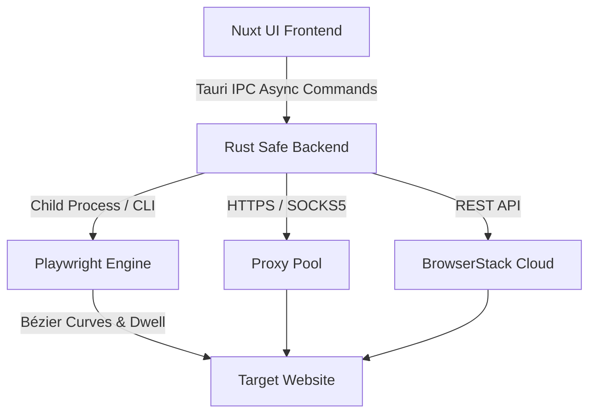

# Introduction to FlashTraffic

**FlashTraffic** is a next-generation desktop platform for simulating human web browsing, stress-testing web server capacity, and verifying web analytics tracking (Google Analytics 4, Plausible, Umami, PostHog, Mixpanel).

Built using **Nuxt 4**, **Nuxt UI**, and a high-performance **Rust / Tauri 2** backend, FlashTraffic combines the power of local Playwright browser automation with real cloud mobile devices on BrowserStack.

:download-card

## Key Capabilities

- **Organic Search Attribution**: Simulate search engine query referrer headers across Google, Bing, Yahoo, Yandex, Baidu, Naver, DuckDuckGo, and Ecosia.
- **Social Media & Inbound Referral**: Simulate traffic origins from Facebook, X (Twitter), YouTube, LinkedIn, Instagram, Reddit, Pinterest, and TikTok.
- **GA4 UTM Tagging**: Verify that custom `utm_campaign`, `utm_medium`, and `utm_source` tags populate correctly in your analytics realtime stream.
- **Human Physics Simulation**: Natural cursor movement calculated with cubic Bézier equations, randomized reading intervals, and multi-page link surfing.
- **Proxy Orchestrator**: Test proxy latency, rotate IP addresses automatically, and filter out dead endpoints.
- **Real Physical Device Matrix**: Execute sessions on actual physical iPhones and Android devices via BrowserStack Automate API.
- **Portable & Offline-First**: All data, campaigns, and credentials stay on your laptop. Export and import settings across computers via `.json` files.

## High-Level Architecture

FlashTraffic uses a local architecture designed for zero data leakage:

